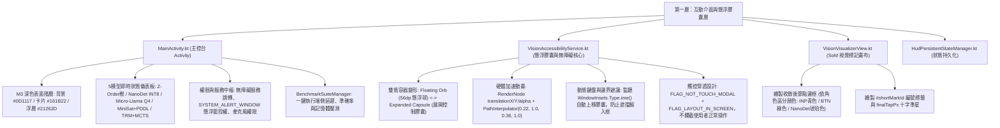
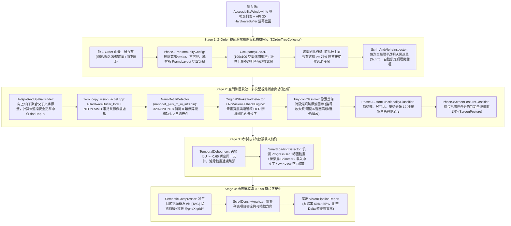
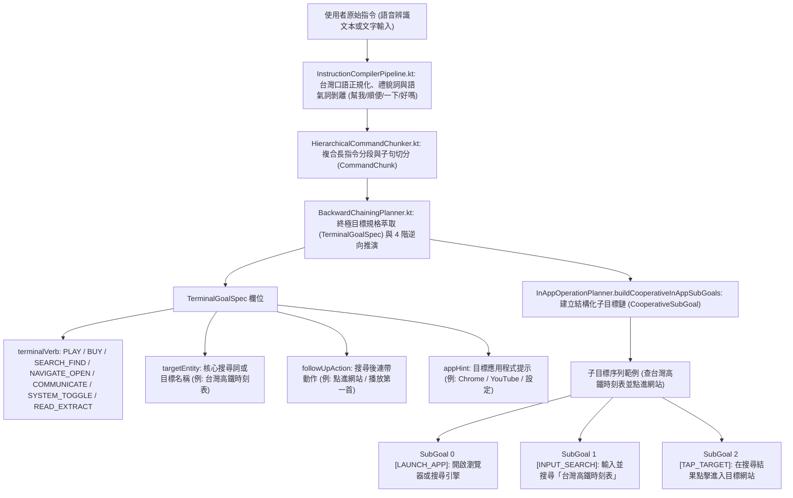
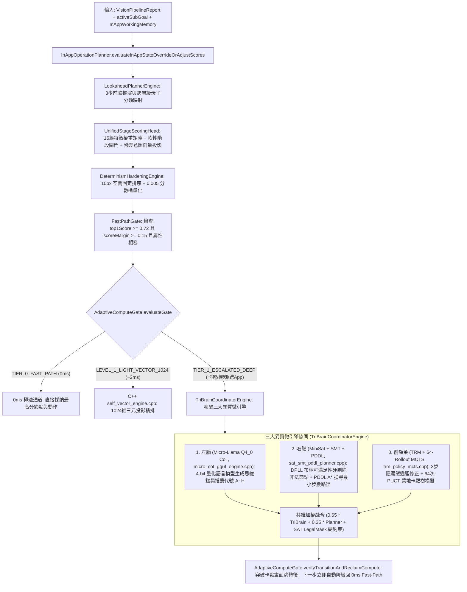
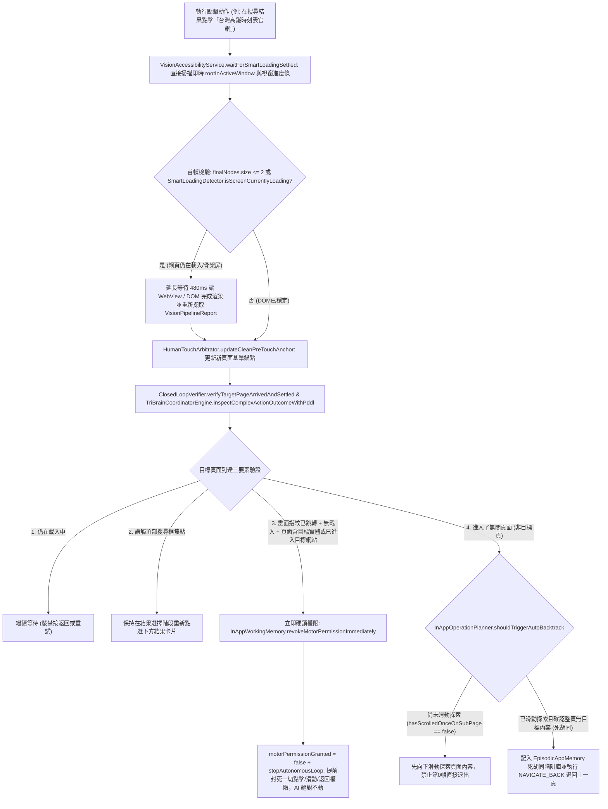
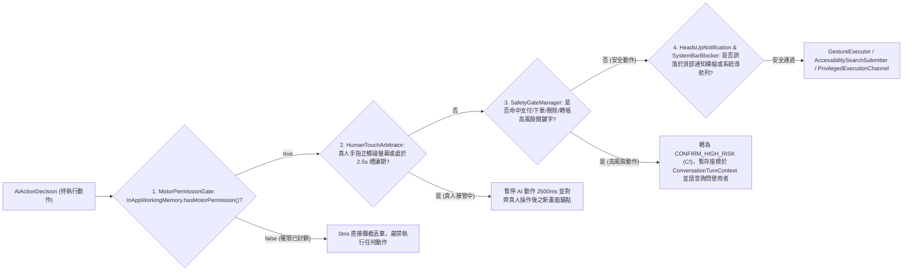
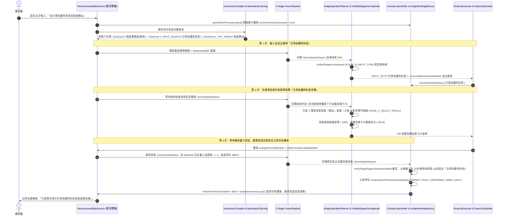

# NewAndroidApp 全系統極致細節完整心智圖與技術白皮書 (Master Mind Map & Ultra-Detailed System Blueprint)

本文件完整記錄 **NewAndroidApp（端側多模態視覺自主 AI 助理）** 的每一個子系統、68 個 Kotlin 核心模組、10 個 C++ JNI 原生推理與訊號處理引擎、8 個離線模型與權重資產、所有關鍵演算法數學公式、常數門檻與閉環安全狀態機。

---

## 目錄 (Table of Contents)
1. [全系統頂層總覽心智圖 (Master Top-Level Mind Map)](#1-全系統頂層總覽心智圖-master-top-level-mind-map)
2. [第一層：互動介面、M3 主控台與懸浮膠囊層 (UI & Floating Overlay HUD)](#2-第一層互動介面m3-主控台與懸浮膠囊層-ui--floating-overlay-hud)
3. [第二層：四階多模態視覺感知管線 (4-Stage Multi-Modal Vision Perception Pipeline)](#3-第二層四階多模態視覺感知管線-4-stage-multi-modal-vision-perception-pipeline)
4. [第三層：自然語言編譯、多子句拆解與逆向鏈推演層 (NLU, Chunking & Backward-Chaining)](#4-第三層自然語言編譯多子句拆解與逆向鏈推演層-nlu-chunking--backward-chaining)
5. [第四層：動態算力門控、統一階段權重頭與異質三腦決策層 (Compute Gate, Unified Scoring Head & Tri-Brain AI)](#5-第四層動態算力門控統一階段權重頭與異質三腦決策層-compute-gate-unified-scoring-head--tri-brain-ai)
6. [第五層：閉環驗證、網頁載入等待、防倒退與自癒記憶層 (Closed-Loop Verifier, Anti-Backtrack & Self-Healing Memory)](#6-第五層閉環驗證網頁載入等待防倒退與自癒記憶層-closed-loop-verifier-anti-backtrack--self-healing-memory)
7. [第六層：多通道手勢執行與人機共駕防衛層 (Multi-Channel Motor Execution & Defense Guards)](#7-第六層多通道手勢執行與人機共駕防衛層-multi-channel-motor-execution--defense-guards)
8. [第七層：獨立程序隔離、零拷貝共享記憶體與 C++ 原生引擎群 (Isolated Process, Zero-Copy IPC & C++ Native Engines)](#8-第七層獨立程序隔離零拷貝共享記憶體與-c-原生引擎群-isolated-process-zero-copy-ipc--c-native-engines)
9. [第八層：12 階自然女聲神經聲碼器與口語人格引擎 (12-Stage Neural Female Vocoder & Colloquial Persona)](#9-第八層12-階自然女聲神經聲碼器與口語人格引擎-12-stage-neural-female-vocoder--colloquial-persona)
10. [端到端全鏈路執行時序圖 (End-to-End Execution Sequence Diagram)](#10-端到端全鏈路執行時序圖-end-to-end-execution-sequence-diagram)
11. [離線模型與權重資產完整清單 (Offline Model & Weight Assets Inventory)](#11-離線模型與權重資產完整清單-offline-model--weight-assets-inventory)

---

## 1. 全系統頂層總覽心智圖 (Master Top-Level Mind Map)

```mermaid
flowchart LR
    ROOT["NewAndroidApp 端側多模態自主 AI 系統"]

    ROOT --> L1["1. 互動介面與懸浮膠囊層 (UI & Overlay HUD)"]
    ROOT --> L2["2. 四階多模態視覺感知管線 (4-Stage Vision Pipeline)"]
    ROOT --> L3["3. 自然語言編譯與逆向鏈推演層 (NLU & Backward-Chaining)"]
    ROOT --> L4["4. 動態算力門控與異質多腦決策層 (Compute Gate & Multi-Brain AI)"]
    ROOT --> L5["5. 閉環驗證、防倒退與自癒記憶層 (Closed-Loop & Memory)"]
    ROOT --> L6["6. 多通道手勢執行與人機共駕防衛層 (Motor & Defense Guards)"]
    ROOT --> L7["7. 獨立程序隔離與零拷貝共享記憶體層 (Isolated IPC & Native C++)"]
    ROOT --> L8["8. 自然女聲神經聲碼器與口語人格層 (Neural Vocoder & Persona)"]

    %% L1
    L1 --> L1_1["MainActivity: M3深色高對比主控台 / 5模型協同儀表板 / 基準測試套件"]
    L1 --> L1_2["VisionAccessibilityService: 無障礙核心 / 懸浮球(Orb)與展開膠囊(Capsule)物理彈簧動畫"]
    L1 --> L1_3["VisionVisualizerView: Set-of-Mark (SoM) 視覺標記框 / #ID 與中心點擊十字準星"]
    L1 --> L1_4["HudPersistentStateManager: 跨服務重啟膠囊座標、展開態與AI模式持久化"]

    %% L2
    L2 --> L2_1["Stage 1 (樹收集與遮擋剔除): ZOrderTreeCollector + Phase1TreeImmunityConfig + OccupancyGrid2D + ScrimAndAlphaInspector"]
    L2 --> L2_2["Stage 2 (多模態視覺補盲): HotspotAndSpatialBinder + NanoDetUiDetector + RoiVisionFallbackEngine + OriginalStrokeTextDetector + TinyIconClassifier"]
    L2 --> L2_3["Stage 2 (功能與姿勢先驗): Phase2ButtonFunctionalityClassifier (12角色) + Phase3ScreenPostureClassifier (全域畫面姿勢)"]
    L2 --> L2_4["Stage 3 (時序防抖與載入偵測): TemporalDebouncer (IoU追蹤) + SmartLoadingDetector (進度條/骨架屏/WebView載入)"]
    L2 --> L2_5["Stage 4 (語義壓縮與網格化): SemanticCompressor (60%~85%壓縮 / 0..999座標正規化 / Delta差分)"]

    %% L3
    L3 --> L3_1["InstructionCompilerPipeline: 台式口語正規化 / 冗詞剝離 / 意圖與槽位編譯"]
    L3 --> L3_2["HierarchicalCommandChunker: 複合長指令多子句拆解 / isolatedMotorGoal 跨步語義隔離"]
    L3 --> L3_3["BackwardChainingPlanner: TerminalGoalSpec 萃取 / 4階逆向目標樹推演 (Level 4 -> Level 1)"]
    L3 --> L3_4["CognitiveReasoningEngine + LocalKnowledgeAndReasoningEngine: 純問答 / 畫面閱讀 / 動作執行三軌路由"]
    L3 --> L3_5["InstalledAppLauncher + CrossAppWorkflowEngine: App別名模糊啟動 / 跨App剪貼簿記憶槽傳遞"]

    %% L4
    L4 --> L4_1["AdaptiveComputeGate: Tier 0 (0ms極速) vs Tier 0.5 (1024D三元向量) vs Tier 1 (三腦深層推論)"]
    L4 --> L4_2["InAppOperationPlanner: Stage A(展開搜尋) -> Stage B(輸入送出) -> Stage C(結果點擊) -> 一般導航"]
    L4 --> L4_3["UnifiedStageScoringHead: 方法1(16維權重矩陣) + 方案B(軟性階段閘門) + 方案C(Gram-Schmidt殘差投影) + 方案E(成對排名蒸餾)"]
    L4 --> L4_4["LookaheadPlannerEngine: 3步前瞻推演 / 跨介面母子目錄同義詞展開 (如 字體大小 -> 顯示與亮度)"]
    L4 --> L4_5["TriBrainCoordinatorEngine: 左腦 Micro-Llama Q4 CoT + 右腦 MiniSat/SMT/PDDL + 前額葉 TRM 3步遞迴 & 64-Rollout MCTS"]
    L4 --> L4_6["DeterminismHardeningEngine: 10px 空間桶固定排序 + 分數桶量化 + FastPath 防搶跑閘門"]

    %% L5
    L5 --> L5_1["ClosedLoopVerifier: 畫面結構指紋對比 / 搜尋結果驗證 / verifyTargetPageArrivedAndSettled 目標網頁到達驗證"]
    L5 --> L5_2["InAppWorkingMemory: MotorPermissionGate 0ms斷電硬鎖 / 導航麵包屑堆疊 / 已送出查詢去重"]
    L5 --> L5_3["Conditional Auto-Backtrack: 等待WebView載入穩定 + 瀏覽器跨套件白名單 + 至少滑動探索一次才允許退出死胡同"]
    L5 --> L5_4["EpisodicAppMemory: 24維語義結構向量匹配(>=0.78) / 死胡同陷阱庫 / 14天指數衰減 / 2次失敗自動熔斷清除"]

    %% L6
    L6 --> L6_1["GestureExecutor: 無障礙原生動作 + 貝茲曲線擬真手勢注入 + 雙向滑動探索 (先下後上)"]
    L6 --> L6_2["AccessibilitySearchSubmitter: ACTION_IME_ENTER -> 鍵盤右下角座標點擊 -> 放大鏡按鈕三級送出"]
    L6 --> L6_3["PrivilegedExecutionChannel: Shizuku / Shell 特權級輸入備援通道"]
    L6 --> L6_4["SafetyGateManager: 高風險支付/刪除/下單二階段 C! 攔截與 ConversationTurnContext 座標暫存"]
    L6 --> L6_5["HumanTouchArbitrator(真人觸控禮讓2.5s) + HeadsUpNotificationDefenseGuard + SystemBarBlockerGuard + ImeDismissGuard"]

    %% L7
    L7 --> L7_1["NeedleIsolatedAiService (:ai_inference 獨立推論程序) + NeedleIsolatedClient"]
    L7 --> L7_2["IpcSharedMemoryTransport: ashmem SharedMemory 零拷貝傳輸 + CRC32 校驗 + 64KB 自動切換"]
    L7 --> L7_3["C++ JNI 原生引擎群: needle_jni / micro_cot_gguf / sat_smt_pddl / trm_policy_mcts / self_vector / zero_copy_vision"]
    L7 --> L7_4["CrashGuardManager + StabilityFlightRecorder + KeepAliveHelper + PlayStoreComplianceHelper"]

    %% L8
    L8 --> L8_1["HumanColloquialPersonaEngine: 去機械感台灣口語改寫 / 零Emoji與零Markdown純淨語音文本"]
    L8 --> L8_2["VoiceCommandAndTtsManager: 連續語音辨識 ASR / 語音指令分派與播報管理"]
    L8 --> L8_3["CuteGirlNeuralTtsEngine + cute_girl_vocoder.cpp: 12階 C++ DSP 自然甜美女聲聲碼器"]
```

---

## 2. 第一層：互動介面、M3 主控台與懸浮膠囊層 (UI & Floating Overlay HUD)

### 2.1 子系統心智圖

### 2.2 模組極致細節規格
- **[MainActivity.kt](file:///e:/NewAndroidApp/app/src/main/java/com/example/newandroidapp/MainActivity.kt)**：
  - **人體工學與視覺規範**：嚴格遵循 Material 3 8dp 空間網格（所有間距為 `8dp / 16dp / 24dp`），所有互動按鈕最小觸控熱區 $\ge 48\text{dp} \times 48\text{dp}$，杜絕 Emoji 與廉價霓虹邊框，採用色調表面高度（Tonal Surface Elevation）區分資訊層級。
  - **對話與指令輸入**：支援文字指令直接送出、語音喚醒切換、以及即時查看 `ConversationManager` 的多輪對話歷史與 `StabilityFlightRecorder` 飛行日誌。
- **[VisionAccessibilityService.kt](file:///e:/NewAndroidApp/app/src/main/java/com/example/newandroidapp/vision/VisionAccessibilityService.kt)**：
  - **懸浮球與展開膠囊共享容器轉換**：
    - 收合態（Floating Orb）：停靠於螢幕左右邊緣（支援拖曳與磁吸貼邊），顯示當前 AI 呼吸燈狀態（待命、思考中、執行手勢中、安全確認等待中）。
    - 展開態（Expanded Capsule）：顯示當前子目標進度、語音/文字輸入框、暫停/終止按鈕與即時推理摘要。
  - **自主閉環排程器 (`scheduleNextAutonomousStep`)**：
    - 整合 `SmartLoadingDetector`、`HumanTouchArbitrator` 與 `InAppWorkingMemory.hasMotorPermission()`，確保每一動皆在畫面穩定且具備動手權限時執行。

---

## 3. 第二層：四階多模態視覺感知管線 (4-Stage Multi-Modal Vision Perception Pipeline)

### 3.1 子系統心智圖

### 3.2 模組極致細節規格
1. **[ZOrderTreeCollector.kt](file:///e:/NewAndroidApp/app/src/main/java/com/example/newandroidapp/vision/ZOrderTreeCollector.kt) & [OccupancyGrid2D.kt](file:///e:/NewAndroidApp/app/src/main/java/com/example/newandroidapp/vision/OccupancyGrid2D.kt)**：
   - 將螢幕切分為 $100 \times 100$ 的二維網格。當上層視窗（如彈出式選單、權限對話框、軟鍵盤）繪製後，會在對應網格填入不透明度權重。下層視窗元件若在網格中的被覆蓋面積比例 $\ge 0.75$，即判定為「視覺不可見」並剔除，徹底解決傳統無障礙服務「點到對話框背後底層按鈕」的通病。
2. **[Phase1TreeImmunityConfig.kt](file:///e:/NewAndroidApp/app/src/main/java/com/example/newandroidapp/vision/dataset/Phase1TreeImmunityConfig.kt) (`assets/ui_phase1_tree_immunity.json`)**：
   - 基於大規模 Android UI 樹統計先驗，自動過濾無意義的裝飾性節點、重複嵌套的 `ViewGroup` 與螢幕外幽靈節點（Ghost Nodes）。
3. **[NanoDetUiDetector.kt](file:///e:/NewAndroidApp/app/src/main/java/com/example/newandroidapp/vision/NanoDetUiDetector.kt) (`assets/nanodet_plus_m_ui_int8.bin`)**：
   - 當遇到 WebView、Flutter、遊戲介面或自繪 Canvas 導致無障礙樹缺乏節點時，啟動第 8 號輕量級視覺模型 `NanoDet-Plus-m INT8`，精準框出 8 大類關鍵 UI 元件：`UI_CLOSE_X`（廣告關閉叉號）、`UI_SEARCH_BAR`（搜尋欄）、`UI_BUTTON_CTA`（主行動按鈕）、`UI_CHECK_SWITCH`（勾選/開關）、`UI_FAB_ADD`（懸浮新增鈕）、`UI_MEDIA_PLAY`（播放/暫停鈕）、`UI_ICON_BACK`（返回鍵）、`UI_ICON_MENU_MORE`（更多選單）。
4. **[Phase2ButtonFunctionalityClassifier.kt](file:///e:/NewAndroidApp/app/src/main/java/com/example/newandroidapp/vision/dataset/Phase2ButtonFunctionalityClassifier.kt) & [Phase3ScreenPostureClassifier.kt](file:///e:/NewAndroidApp/app/src/main/java/com/example/newandroidapp/vision/dataset/Phase3ScreenPostureClassifier.kt)**：
   - **Phase 2（單一元件功用分類）**：將元件分類為 `SEARCH_ACTIVATOR`、`PRIMARY_SUBMIT_CTA`、`CONTENT_CARD_ITEM`、`NAVIGATION_TAB`、`MODAL_DISMISS_Action`、`BACK_NAVIGATOR`、`FILTER_SORT_CHIP`、`MEDIA_PLAY_CONTROL` 等 12 種角色。
   - **Phase 3（全域畫面姿勢判定）**：根據全畫面元件的空間拓撲，判定當前畫面屬於 `SEARCH_RESULTS_LIST`（搜尋結果列表）、`HOME_FEED_BROWSE`（首頁探索流）、`ARTICLE_DETAIL_VIEW`（文章/網頁內頁）、`MODAL_POPUP_DIALOG`（彈窗遮擋）、`CHECKOUT_PAYMENT`（結帳付款頁）或 `SETTINGS_LIST`（設定列表），並提供對應的戰術加權。

---

## 4. 第三層：自然語言編譯、多子句拆解與逆向鏈推演層 (NLU, Chunking & Backward-Chaining)

### 4.1 子系統心智圖

### 4.2 模組極致細節規格
- **[HierarchicalCommandChunker.kt](file:///e:/NewAndroidApp/app/src/main/java/com/example/newandroidapp/ai/HierarchicalCommandChunker.kt)**：
  - **跨步語義隔離 (`isolatedMotorGoal`)**：當執行到某一個 `CooperativeSubGoal` 時，只將該步專屬的 `targetSemanticPhrase` 傳遞給底層評分器，防止後半句的詞彙（如「然後按結帳」）在前半句（如「搜尋商品」）時提早污染當前畫面的按鈕評分。
- **[BackwardChainingPlanner.kt](file:///e:/NewAndroidApp/app/src/main/java/com/example/newandroidapp/stability/BackwardChainingPlanner.kt)**：
  - **4 階逆向目標樹 (4-Level Backward-Chaining)**：
    - `LEVEL_4_DISMISS_BLOCKER`：優先清除遮擋視線的彈窗或同意條款。
    - `LEVEL_1_DIRECT_TARGET`：若目標已在畫面上，直接點擊。
    - `LEVEL_2_INPUT_KEYWORD`：若目標不在畫面上但有搜尋框 (`INP`)，直接輸入關鍵字。
    - `LEVEL_3A_EXPAND_SEARCH_BOX` / `LEVEL_3B_BOTTOM_SEARCH_TAB`：若畫面連搜尋框都沒有，先找頂部放大鏡圖示或底部「搜尋」分頁點開搜尋框。
- **[CognitiveReasoningEngine.kt](file:///e:/NewAndroidApp/app/src/main/java/com/example/newandroidapp/ai/CognitiveReasoningEngine.kt) & [LocalKnowledgeAndReasoningEngine.kt](file:///e:/NewAndroidApp/app/src/main/java/com/example/newandroidapp/ai/LocalKnowledgeAndReasoningEngine.kt)**：
  - 區分「純知識問答（如：高鐵左營到台北要多久）」、「當前畫面視覺問答（如：幫我看畫面上這個商品多少錢）」與「UI 操控指令」，純問答直接以 0ms 回覆，絕不誤觸螢幕按鈕。

---

## 5. 第四層：動態算力門控、統一階段權重頭與異質三腦決策層 (Compute Gate, Unified Scoring Head & Tri-Brain AI)

### 5.1 子系統心智圖

### 5.2 統一階段條件式權重頭與三合一邏輯升級 ([`UnifiedStageScoringHead.kt`](file:///e:/NewAndroidApp/app/src/main/java/com/example/newandroidapp/ai/UnifiedStageScoringHead.kt))

為了避免規則疊床架屋導致衝突，系統將決策評分收斂為統一的數學矩陣模型（權重儲存於 [`assets/ui_stage_scoring_weights.json`](file:///e:/NewAndroidApp/app/src/main/assets/ui_stage_scoring_weights.json)）：

1. **16 維正規化節點特徵向量 $\mathbf{x}_i \in [-1, 1]^{16}$**：
   - $x_{i,0}$ (`exact_or_norm_query_match`)：目標字串精確或包含匹配品質 $[0, 1]$。
   - $x_{i,1}$ (`subword_bigram_semantic_sim`)：字元交集與 Bigram 雙字詞重疊度 $[0, 1]$。
   - $x_{i,2}$ (`residual_intent_and_website_affinity`)：方案 C 語義殘差向量親和度與官網/網址特徵 $[0, 1]$。
   - $x_{i,3}$ (`is_search_entry_role`)：是否為搜尋輸入框 `INP` $[0, 1]$。
   - $x_{i,4}$ (`is_search_activator_icon`)：是否為搜尋放大鏡或搜尋入口按鈕 $[0, 1]$。
   - $x_{i,5}$ (`is_ime_or_submit_action`)：是否為鍵盤右下角送出鍵或搜尋確認鈕 $[0, 1]$。
   - $x_{i,6}$ (`is_top_search_bar_echo`)：是否為頂部 $Y \le 265$ 已填入查詢詞之搜尋欄回音 $[0, 1]$。
   - $x_{i,7}$ (`is_filter_tab_chip`)：是否為「全部/圖片/新聞/影片」等結果頁過濾標籤 $[0, 1]$。
   - $x_{i,8}$ (`is_main_viewport_result_card`)：是否為位於主視窗 $Y \in [250, 900]$ 之有效內容結果卡片 $[0, 1]$。
   - $x_{i,9}$ (`phase2_role_match_score`)：Phase 2 按鈕功用分類器匹配分 $[-1, 1]$。
   - $x_{i,10}$ (`phase3_posture_tactical_score`)：Phase 3 全域畫面姿勢戰術加權 $[-1, 1]$。
   - $x_{i,11}$ (`viewport_vertical_salience`)：垂直視窗黃金熱區顯著性 $[0, 1]$。
   - $x_{i,12}$ (`area_and_visual_salience`)：面積與 NanoDet 視覺信心度 $[0, 1]$。
   - $x_{i,13}$ (`episodic_memory_delta`)：24 維自癒情節記憶加減分 $[-1, 1]$。
   - $x_{i,14}$ (`already_clicked_penalty`)：同畫面重複點擊懲罰 $[0, 1]$。
   - $x_{i,15}$ (`constant_bias_one`)：常數偏置項 $1.0$。

2. **方案 B：軟性階段機率閘門 (Soft Stage Probability Gating)**：
   - 萃取 8 維全局畫面狀態向量 $\mathbf{s}_{\text{screen}} \in [0, 1]^8$（包含 `has_query`、`is_query_submitted`、`has_input_box`、`input_contains_query`、`matching_result_density`、`is_search_results_posture`、`top_input_focused`、`is_general_nav`）。
   - 透過閘門矩陣 $\mathbf{W}_{\text{gate}} \in \mathbb{R}^{5 \times 8}$ 計算 5 個階段（`STAGE_A_EXPAND_SEARCH`、`STAGE_B_INPUT_TYPE`、`STAGE_B_SUBMIT_QUERY`、`STAGE_C_SELECT_RESULT`、`IN_APP_NAVIGATION`）的連續機率分佈：
     $$\mathbf{p}_{\text{stage}} = \text{Softmax}(\mathbf{W}_{\text{gate}} \mathbf{s}_{\text{screen}} + \mathbf{b}_{\text{gate}})$$
   - 最終分數為各階段條件式得分（含雙線性交互項 $M_r(u, v) x_{i,u} x_{i,v}$）的機率期望值：
     $$S_{\text{total}}(\text{node}_i) = \sum_{r \in \text{Regimes}} p_{\text{stage}}[r] \cdot \left( b_r + \mathbf{w}_r^\top \mathbf{x}_i + \sum_{(u,v)} M_r(u, v) x_{i,u} x_{i,v} \right)$$
   - 在 `STAGE_C_SELECT_RESULT` 階段，頂部搜尋欄（$x_{i,3}=1$ 或 $x_{i,6}=1$）權重為 $-180.0$，而主視窗中包含目標實體與官網殘差意圖的結果卡片（$x_{i,8} \cdot x_{i,0}$ 與 $x_{i,8} \cdot x_{i,2}$）獲得 $+68.0 \sim +92.0$ 的雙線性交互增益，從數學底層根除「查完高鐵時刻表卻重點頂部搜尋框或過濾標籤」的問題。

3. **方案 C：Gram-Schmidt 語義殘差向量消去投射 (`computeResidualIntentProjection`)**：
   - 將完整使用者指令編碼為語義向量 $\mathbf{v}_{\text{goal}}$，已完成之搜尋查詢編碼為 $\mathbf{v}_{\text{done}}$，計算正交殘差向量：
     $$\mathbf{v}_{\text{residual}} = \text{Normalize}\left(\mathbf{v}_{\text{goal}} - \frac{\mathbf{v}_{\text{goal}} \cdot \mathbf{v}_{\text{done}}}{\|\mathbf{v}_{\text{done}}\|^2 + 10^{-6}}\mathbf{v}_{\text{done}}\right)$$
   - 自動提取尚未完成的殘差意圖（例如「點進網站」、「看官網」、「打開來聽」）並注入 $x_{i,2}$ 特徵。

---

## 6. 第五層：閉環驗證、網頁載入等待、防倒退與自癒記憶層 (Closed-Loop Verifier, Anti-Backtrack & Self-Healing Memory)

### 6.1 網頁載入等待、目標確認與硬體級權限鎖死心智圖

### 6.2 模組極致細節規格
- **[ClosedLoopVerifier.kt](file:///e:/NewAndroidApp/app/src/main/java/com/example/newandroidapp/stability/ClosedLoopVerifier.kt)**：
  - `verifySearchSubmittedAndResultsVisible`：專用於 `INPUT_SEARCH` 子目標，驗證搜尋詞已送出且搜尋結果列表已呈現。
  - `verifyTargetPageArrivedAndSettled`：專用於 `TAP_TARGET`（如點進網站、點開文章/影片），確認 (a) `!SmartLoadingDetector.isScreenCurrentlyLoading`、(b) 頂部搜尋欄未處於編輯焦點、(c) 畫面指紋已改變且頁面內容包含目標實體或已脫離搜尋結果列表；一旦確認為最終步驟，立即在驗證函數內部呼叫 `InAppWorkingMemory.revokeMotorPermissionImmediately("TARGET_PAGE_CONFIRMED_HARD_LOCK")`。
- **[InAppWorkingMemory.kt](file:///e:/NewAndroidApp/app/src/main/java/com/example/newandroidapp/stability/InAppWorkingMemory.kt)**：
  - **動手權限總閘門 (`motorPermissionGranted: AtomicBoolean`)**：
    - 僅在使用者下達新操控指令時呼叫 `grantMotorPermission(goal)` 開啟。
    - 當達成目標時呼叫 `revokeMotorPermissionImmediately(reason)`，原子化設為 `false`。
    - [`VisionAccessibilityService`](file:///e:/NewAndroidApp/app/src/main/java/com/example/newandroidapp/vision/VisionAccessibilityService.kt) 中所有 `TAP`、`LONG_PRESS`、`SCROLL`、`INPUT_TEXT`、`NAVIGATE_BACK`、`dismissBlockingImeIfNeeded` 與 `handleHumanTouchDetectedOnScreen` 皆受 `InAppWorkingMemory.hasMotorPermission()` 硬體級攔截保護。

---

## 7. 第六層：多通道手勢執行與人機共駕防衛層 (Multi-Channel Motor Execution & Defense Guards)

### 7.1 子系統心智圖

---

## 8. 第七層：獨立程序隔離、零拷貝共享記憶體與 C++ 原生引擎群 (Isolated Process, Zero-Copy IPC & C++ Native Engines)

### 8.1 C++ JNI 原生檔案與職責一覽表

| C++ 原始碼檔案 | 編譯目標與職責 | 核心演算法與硬體加速細節 |
| :--- | :--- | :--- |
| [needle_jni.cpp](file:///e:/NewAndroidApp/app/src/main/cpp/needle_jni.cpp) & [needle.h](file:///e:/NewAndroidApp/app/src/main/cpp/needle.h) | `libneedle_jni.so` JNI 總橋接層 | 封裝 Kotlin `NeedleNativeBridge` 與所有 C++ 子引擎之零拷貝 Direct ByteBuffer / FloatArray 介面。 |
| [micro_cot_gguf_engine.cpp](file:///e:/NewAndroidApp/app/src/main/cpp/micro_cot_gguf_engine.cpp) | 左腦：Micro-Llama Q4_0 GGUF 推理引擎 | 支援 `mmap` 直接映射 `micro_cot_llama_q4.gguf`，實作 Q4_0 區塊反量化與 ARM NEON `vdotq_s32` 矩陣向量乘法 (GEMV)、RMSNorm、RoPE 旋轉位置編碼與 KV Cache。 |
| [sat_smt_pddl_planner.cpp](file:///e:/NewAndroidApp/app/src/main/cpp/sat_smt_pddl_planner.cpp) | 右腦：MiniSat + QF_LIA SMT + PDDL A* 規劃器 | 1. **MiniSat DPLL**：以單子句傳播 (Unit Propagation) 硬性剔除語音麥克風、已點擊死胡同、被遮擋節點與不相容角色。 2. **SMT 幾何驗算**：驗證點擊座標落在安全視窗邊界內。 3. **PDDL A* 搜尋**：根據前置條件 (Preconditions) 與效果 (Effects) 推導最短動作序列。 |
| [trm_policy_mcts.cpp](file:///e:/NewAndroidApp/app/src/main/cpp/trm_policy_mcts.cpp) | 前額葉：TRM 3步遞迴策略與 64-Rollout MCTS | 載入 `trm_policy_mcts_int8.bin`，先執行 3 步隱藏狀態遞迴去噪 ($h^{(t+1)} = \text{LayerNorm}(h^{(t)} + \text{MLP}(h^{(t)}, x))$)，再執行 64 次 PUCT 蒙地卡羅樹模擬（$U(s,a) = Q(s,a) + c_{\text{puct}} P(s,a) \frac{\sqrt{\sum_b N(s,b)}}{1 + N(s,a)}$）。 |
| [self_vector_engine.cpp](file:///e:/NewAndroidApp/app/src/main/cpp/self_vector_engine.cpp) | Level 0.5：1024 維三元向量引擎 | 採用 $\{-1, 0, +1\}$ 三元稀疏權重投影（免浮點乘法），在 `< 2ms` 內完成 1024 維語義與空間特徵餘弦相似度精排。 |
| [zero_copy_vision_accel.cpp](file:///e:/NewAndroidApp/app/src/main/cpp/zero_copy_vision_accel.cpp) | 視覺零拷貝硬體加速引擎 | 透過 `AHardwareBuffer_lock` 直接存取螢幕截圖像素，以 NEON SIMD 執行雙線性縮放、ROI 裁切與邊緣梯度計算。 |
| [cute_girl_vocoder.cpp](file:///e:/NewAndroidApp/app/src/main/cpp/cute_girl_vocoder.cpp) | `libcutegirl_vocoder.so` 12 階女聲聲碼器 | 專職處理 PCM 音訊流之時域基音同步拉伸 (WSOLA)、共振峰包絡偏移與自然女聲頻譜塑形。 |

---

## 9. 第八層：12 階自然女聲神經聲碼器與口語人格引擎 (12-Stage Neural Female Vocoder & Colloquial Persona)

### 9.1 12 階 C++ DSP 自然女聲處理管線 ([`cute_girl_vocoder.cpp`](file:///e:/NewAndroidApp/app/src/main/cpp/cute_girl_vocoder.cpp) & [`CuteGirlNeuralTtsEngine.kt`](file:///e:/NewAndroidApp/app/src/main/java/com/example/newandroidapp/stability/CuteGirlNeuralTtsEngine.kt))

```mermaid
flowchart LR
    IN_TEXT["AI 決策或回答文本"] --> PERSONA["HumanColloquialPersonaEngine: 移除機械日誌與符號，轉為溫柔簡潔台灣口語"]
    PERSONA --> BASE_TTS["Android TextToSpeech 基底合成為原始 PCM 波型 (basePitch=1.0, baseRate=0.96)"]
    BASE_TTS --> S1["Stage 1-2: 雙階基音同步 WSOLA (Pitch=1.17x, Formant=1.07x, 獨立控制音高與聲道長度)"]
    S1 --> S3["Stage 3-4: 220Hz 基頻柔性上限保護 (Soft F0 Ceiling) + Fujisaki 自然語調曲線 (句首微揚/句尾柔和下降)"]
    S3 --> S5["Stage 5-6: 5.5Hz 微顫音 (Micro-Vibrato) + 210Hz 胸腔溫暖共鳴雙二階濾波器 (+2.2dB)"]
    S5 --> S7["Stage 7-8: 2.65kHz 人聲親近感峰值 (+1.8dB) + 4.5kHz 動態齒音抑制器 (Dynamic De-Esser, 消除尖銳金屬感)"]
    S7 --> S9["Stage 9-10: Liljencrants-Fant 聲門氣音混合 (Pink-Noise Aspiration) + 句間自然換氣停頓"]
    S9 --> S11["Stage 11-12: 8 頻段柔性限幅器 (tanh Soft-Clipper) + 零延遲 AudioTrack 串流播報"]
```

---

## 10. 端到端全鏈路執行時序圖 (End-to-End Execution Sequence Diagram)

以下以使用者指令 **「幫我查台灣高鐵時刻表並點進網站」** 為例，展示全系統從接收指令到進入目標網站並硬體級鎖死動手權限的完整時序：

---

## 11. 離線模型與權重資產完整清單 (Offline Model & Weight Assets Inventory)

所有模型與蒸餾權重皆 100% 封裝於 APK 內部 `app/src/main/assets/`，無需依賴雲端伺服器或單機作弊記憶，確保安裝於任何 Android 手機皆具備完全一致的高階推理能力：

1. [`assets/ui_stage_scoring_weights.json`](file:///e:/NewAndroidApp/app/src/main/assets/ui_stage_scoring_weights.json)：方法 1 + 方案 B + 方案 E 之 5 階段 $\times$ 16 維權重矩陣 $\mathbf{W}_{\text{stage}}$、雙線性交互項 $\mathbf{M}_{\text{stage}}$ 與 $5 \times 8$ 軟性階段機率閘門權重 $\mathbf{W}_{\text{gate}}$。
2. [`assets/micro_cot_llama_q4.gguf`](file:///e:/NewAndroidApp/app/src/main/assets/micro_cot_llama_q4.gguf)：左腦 Micro-Llama Q4_0 量化語言思維鏈模型權重。
3. [`assets/trm_policy_mcts_int8.bin`](file:///e:/NewAndroidApp/app/src/main/assets/trm_policy_mcts_int8.bin)：前額葉 TRM 3 步遞迴策略與價值網路 INT8 權重（供 64-Rollout MCTS 使用）。
4. [`assets/nanodet_plus_m_ui_int8.bin`](file:///e:/NewAndroidApp/app/src/main/assets/nanodet_plus_m_ui_int8.bin)：Stage 2 視覺補盲 `NanoDet-Plus-m` 8 類 UI 元件偵測模型 INT8 權重。
5. [`assets/ui_phase1_tree_immunity.json`](file:///e:/NewAndroidApp/app/src/main/assets/ui_phase1_tree_immunity.json)：Stage 1 無障礙樹幽靈節點與冗餘容器免疫過濾先驗。
6. [`assets/ui_phase2_button_functionality.json`](file:///e:/NewAndroidApp/app/src/main/assets/ui_phase2_button_functionality.json)：Stage 2 AMEX 102K 12 種按鈕功用角色分類權重。
7. [`assets/ui_phase3_screen_posture.json`](file:///e:/NewAndroidApp/app/src/main/assets/ui_phase3_screen_posture.json)：Stage 2 全域畫面姿勢（搜尋列表、首頁、內頁、彈窗、結帳等）分類先驗。
