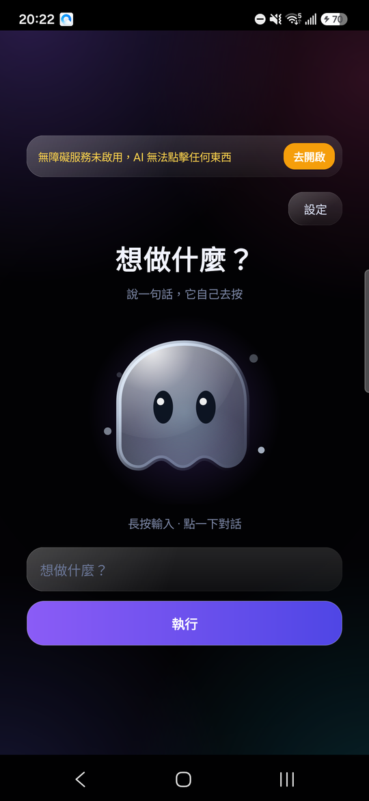
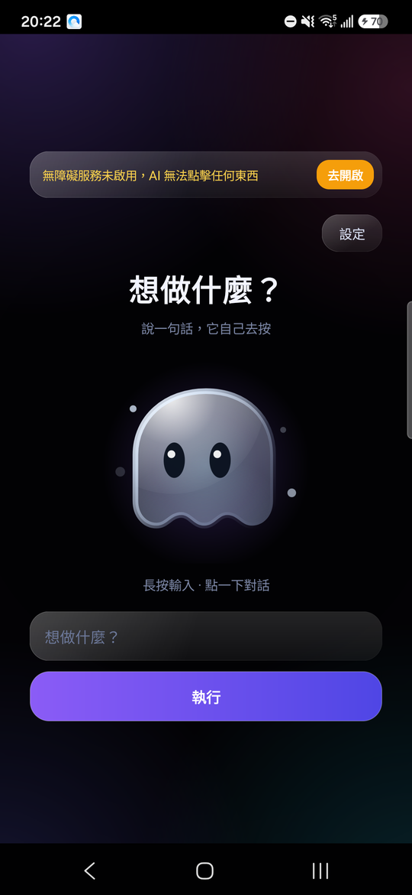

# WAE — 離線可驗證的 Android 手機代理人

[](https://github.com/AXIIIlll/wae-agent/actions/workflows/android.yml)
[](https://github.com/AXIIIlll/wae-agent/releases)


> 說一句話，它在任意 App 裡把事做完，而且**每一步都能被檢驗**——全程離線、不上傳任何資料。

<table>
<tr>
<td width="45%"></td>
<td width="45%"></td>
</tr>
<tr>
<td align="center"><sub>主畫面：一句話輸入</sub></td>
<td align="center"><sub>設定：系統檢查與一鍵修復</sub></td>
</tr>
</table>

## 這是什麼

一個跑在 Android 上的**代理式自動操作引擎**：用無障礙 API 讀畫面、用資料驅動的規則決定要點哪裡，
用系統 API 完成能量測結果的操作（音量、亮度、開關）。沒有生成式 LLM，沒有網路權限。

| 特性 | 做法 |
|---|---|
| **物理離線** | Manifest 以 `tools:node="remove"` 移除 `INTERNET`；程式碼 0 個 HTTP 呼叫 |
| **全離線語音** | 內建 sherpa-onnx 中文 zipformer int8 模型（APK 自帶，零下載） |
| **可驗證** | 每步都有後置條件（畫面變化／開關狀態／API 讀回），不成立就重規劃 |
| **通用** | 意圖／模板／策略全在 TSV；新增 App 或說法是加資料，不改程式 |
| **安全** | 風險分級（BLOCK／CONFIRM）、敏感操作確認卡、前 20 次安全模式、可復原 |

## 快速開始

需求：JDK 21、Android SDK、一台 Android 11（API 30）以上的手機。

```powershell
# 1) 建置與測試
.\gradlew.bat :core:test :app:testFullDebugUnitTest :app:assembleFullDebug

# 2) 安裝
adb install -r app\build\outputs\apk\full\debug\app-full-debug.apk

# 3) 綁定無障礙（安裝後一定要重做，Android 會解除綁定）
adb shell settings put secure enabled_accessibility_services com.wae.agent/com.wae.agent.core.WaeVisionAccessibilityService
adb shell settings put secure accessibility_enabled 1

# 4) 麥克風與助理角色（選用）
adb shell pm grant com.wae.agent android.permission.RECORD_AUDIO
adb shell cmd role add-role-holder android.app.role.ASSISTANT com.wae.agent
```

想直接下載 APK：見 [Releases](https://github.com/AXIIIlll/wae-agent/releases)（CI 產出，debug 簽章）。

## 它怎麼運作

```
使用者一句話
   ↓ ① 明確度判定（句型／App／目標物／詞彙覆蓋率）
   ↓ ② 計畫（每步帶前置與後置條件）
   ↓ ③ 畫面簡化器：把無障礙樹收成「可選項」清單
   ↓ ④ 計畫 ↔ 選項比對（動作相容性 → 標籤 → 群組 → 概念同族）
   ↓ ⑤ 點擊策略＋驗證（節點 → 可點祖先 → 容器中心 → 同名候選）
   ↓ ⑥ 後置條件不成立 → 重規劃（並記入負面知識）
```

幾個實測得到的設計決定：

- **只從「可互動」的節點挑目標**：純說明文字即使字面完全相符也不點（避免「假成功」）
- **指紋排除會跳動的文字**：時鐘秒數每秒變，否則「畫面有沒有變」永遠為真
- **概念表處理說法差異**：目標「通話紀錄」、畫面只寫「最近記錄」時仍能命中
- **選單候選用位置排序**：Chrome 兩個三點圖示靠「是否在網頁內容裡」區分

## 專案結構

| 目錄 | 內容 |
|---|---|
| `core/` | 純 Kotlin：決策、規劃、畫面模型、資料載入（可 JVM 測試） |
| `app/` | Android：無障礙服務、UI、語音、視覺通道 |
| `app/src/main/assets/open_source_ai_databases/` | 全部資料表（TSV） |
| `benchmark/` | 100 題任務集與結果 |
| `tools/` | 建置／驗證／評測腳本 |
| `docs/` | 架構與決策文件（索引：`docs/README.md`） |

## 品質關卡

```powershell
powershell -File tools\debt_report.ps1                          # 五項債務指標
.\gradlew.bat :core:test :app:testFullDebugUnitTest             # 1,500+ 單元測試
```

CI 每次 push 會跑：單元測試與守門測試、資料政策（TSV 無 BOM、UI 無 emoji）、建置 APK。
PR 前請看 [CONTRIBUTING.md](CONTRIBUTING.md)（五條硬規則）。

## 文件

- 索引：[docs/README.md](docs/README.md)
- 架構：[docs/WAE_Atlas_Architecture.md](docs/WAE_Atlas_Architecture.md)、[docs/WAE_Gen5_Architecture.md](docs/WAE_Gen5_Architecture.md)
- 穩定度與覆蓋率路線：[docs/WAE_Stability_Coverage_Plan.md](docs/WAE_Stability_Coverage_Plan.md)
- 怎麼驗證：[docs/WAE_How_To_Verify.md](docs/WAE_How_To_Verify.md)
- 為什麼不用 LLM：[docs/WAE_NoLLM_Plan.md](docs/WAE_NoLLM_Plan.md)
- 服務拆分：[docs/WAE_Service_Decomposition.md](docs/WAE_Service_Decomposition.md)
- 評測方法：[docs/WAE_Benchmark.md](docs/WAE_Benchmark.md)
- 綠區政策：[docs/GREEN_ZONE_POLICY.md](docs/GREEN_ZONE_POLICY.md)

## 已知限制

- **不是所有 App 都能操作**：Canvas／Flutter／遊戲等無障礙節點稀疏的畫面，只能靠 OCR 與座標
- **自繪元件**：頁籤、彈出選單有時點不動，需要「策略＋驗證」逐一嘗試（成本較高）
- **平台限制**：Android 10+ 第三方 App 無法直接開關 Wi-Fi／藍牙／飛航；亮度需要 `WRITE_SETTINGS`
- **只在 Samsung Galaxy（Android 14）驗證過**，其他機型未測
- **語音**：數字與專有名詞辨識仍弱；真人麥克風尚未建立成功率基線

## 授權

私有軟體，保留所有權利（見 [LICENSE](LICENSE)）。第三方元件的授權見
[THIRD-PARTY-LICENSES.md](THIRD-PARTY-LICENSES.md)。
